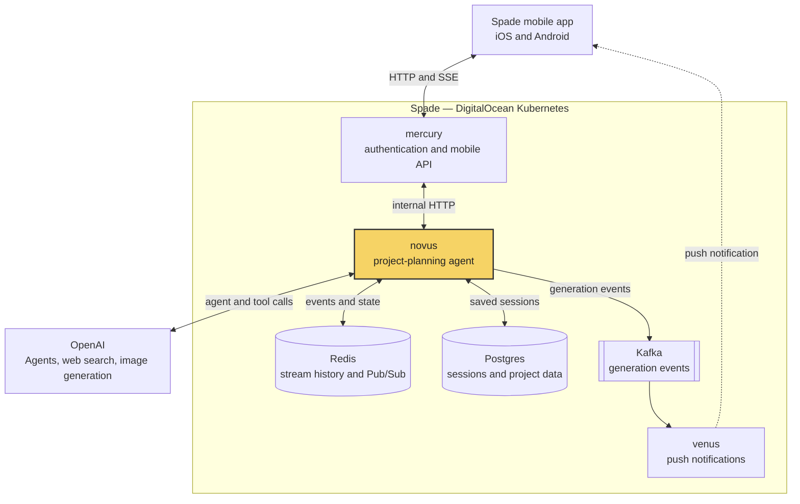
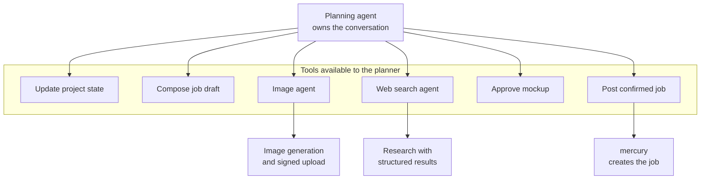
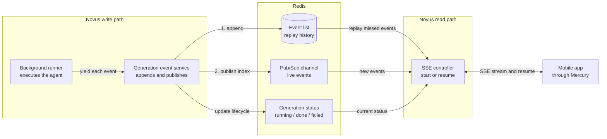

# Building Novus, the AI Agent Behind Spade

When we were building Spade, the idea was pretty straightforward. A homeowner posts a job, local service providers bid on it, and the homeowner chooses who they want to work with.

Simple enough, at least on paper.

There was one part of that process I kept thinking about, though. We were asking homeowners to describe the work they needed done, often without really knowing what that work involved.

Say you want to redo your backyard. You probably know what you want it to _look_ like. Maybe you have a few pictures saved on your phone. But do you know what materials you want? How to explain the scope? Which trade should even be doing the work?

I certainly wouldn't know the answer to all of those questions.

And yet, we expected someone to figure that out, write a decent job description, and send it off to contractors who had to decide whether the job was worth bidding on.

That was the idea behind **Novus**, Spade's AI project-planning service. Instead of giving homeowners another form to fill out, what if they could just talk through what they wanted to build?

Of everything I built at Spade, Novus was probably the service I was most proud of. It was also the most technically challenging. Not because I had to write some groundbreaking AI model, but because making an AI agent behave like a reliable part of a real application turned out to be a very different problem from getting one to respond in a chat window.

## From a rough idea to a real job post

The experience I wanted was something like this:

A homeowner opens Spade and says they want to build a deck. Novus asks a few questions to understand the project. How big? What kind of material? Is there an existing deck to remove? If the homeowner isn't sure about something, the agent can research options and help them understand the trade-offs.

They can also upload a photo of their backyard and ask Novus to show them what the finished project might look like. The image agent generates a mockup, and they can iterate on it until they have something closer to what they had in mind.

All the while, Novus is keeping track of the actual project details. It isn't just having a conversation and hoping it remembers everything. It's building up structured state that can eventually be turned into a job draft.

Once the homeowner is happy, Novus presents that draft for review. The homeowner can edit it or explicitly confirm that they want to post it. Only then does Novus create the job in Spade's marketplace.

There was also a smaller, separate agent called _Express Post_. If someone didn't want to go through the planning experience, it could take a quick job description and clean it up into a better title and description.

That was the product. Here is where it sat technically.

## Where Novus fit into Spade

Spade was made up of several backend services running on Kubernetes. But I always thought of Novus a little differently from the other services.

Mercury was our product API. It handled requests from the mobile app and owned the marketplace workflows. **Novus was meant to be an internal platform service**, something other products and services across Spade could use. The project-planning agent was just the first use case.

My longer-term vision was for Novus to give us a shared understanding of a homeowner across our products. If someone spent an hour planning a deck, I didn't want them to have to explain all of that again when they used another Spade product six months later. With the right permissions and boundaries, that context could follow them and make the experience more useful.

I also imagined expanding Novus into personalization: recommending things that were actually relevant, tailoring push notifications and in-app messages, and eventually building marketing campaigns around what someone was interested in rather than sending everyone the same thing. On the marketplace side, it could help us understand whether someone was just exploring a project or genuinely ready to hire, how likely they were to respond to a provider, or whether they might accept a bid. That kind of marketplace intelligence could help us better connect homeowners and providers.

To be clear, that was the vision, not a list of features we shipped. But it's why I didn't want Novus to be just another API that the mobile app called directly.

Instead, Novus stayed private inside the cluster. The mobile app talked to **Mercury**, which authenticated the homeowner and forwarded requests to Novus. Mercury still owned jobs, users, and uploads. Novus could focus on the AI capabilities, with room for other services and future products to use them too.

The interesting thing about this setup was that Novus could do quite a lot without actually owning very much. It could generate mockups, but it requested signed upload URLs from Mercury rather than managing storage itself. It could prepare a job, but Mercury was still the service that created it. And it could publish events to Kafka so our notification service, Venus, could let the homeowner know when background work had finished.

That separation was important once the agent started doing more than just returning text.

## I didn't want one giant prompt doing everything

Novus was built using the OpenAI Agents SDK. The core of it was a planning agent that owned the conversation, but I didn't want that one agent to be responsible for every little thing.

Instead, I used an **agents-as-tools** approach. The planning agent could call specialist agents for things like image generation and web research, alongside regular tools for updating the project, composing a draft, approving a mockup, or posting a confirmed job.

To me, this was a much cleaner way to build the system. The planning agent could decide _when_ it needed research or a mockup without having to manage the details of how those things worked.

The structured project state was just as important. An LLM might be good at following a conversation, but I didn't want the final job post to depend entirely on what it happened to remember from twenty messages ago. The state gave the agent something concrete to update as the project became clearer.

And there were boundaries. The agent wasn't supposed to pretend to be a licensed contractor, guarantee building-code compliance, or confidently invent exact prices. Most importantly, **it couldn't post a job until the homeowner confirmed it**.

I wanted an assistant that helped someone make a better decision, not one that made the decision for them.

## Making the stream survive a disappearing phone

Getting the agents to call the right tools took work, but the part of Novus that took the most design effort was the streaming system.

A normal chat response might take a few seconds. A Novus turn could involve reasoning, web research, multiple tool calls, and generating an image. That could take much longer, especially if the user wanted to iterate on a mockup.

Now imagine the homeowner backgrounds the app halfway through that process. Or they move between Wi-Fi and cellular. Or the connection just drops, because mobile connections do that.

The most obvious implementation would have been one long-running HTTP request: start the agent, stream its output back to the phone, and finish when the agent finishes.

But that ties two things together that really shouldn't depend on each other: **the work being done and the connection used to watch it**.

There was another consideration too. Novus was a Kubernetes service, so I wanted the design to support multiple instances. If the events only lived in memory, a homeowner could reconnect to a different instance and that instance would have no idea what had happened so far.

So I separated the generation from the stream.

Instead of keeping the agent's output inside the HTTP request, Novus started a detached background runner. That runner would continue generating and publishing events independently of whether the client was still connected. The HTTP side became a way to _observe_ the generation rather than the thing keeping it alive.

Redis was what connected the two.

Every event produced by the agent was appended to a Redis list and then published to a Redis Pub/Sub channel. The list was the history. Pub/Sub was just the live notification that something new had arrived.

I think that's an important distinction. Pub/Sub by itself doesn't remember messages for a subscriber that wasn't connected. If the client missed an event, there was nothing to replay. The Redis list solved that part.

Each event was assigned an index, which became its Server-Sent Events (SSE) ID. When a phone reconnected, it could tell Novus the last event it had seen. Novus would read the missing events from Redis, replay them, and then switch over to the live Pub/Sub stream. It also tracked event IDs during the handoff so it wouldn't send the same event twice.

From the homeowner's perspective, the goal was pretty unremarkable: they could leave the app, come back, and still see what Novus had been doing.

From my perspective, that simple behaviour was easily the most satisfying part of the system to build.

Imagine the app receives events 0 and 1, then loses its connection. The agent keeps working and records events 2, 3, and 4 in Redis. When the phone reconnects, even if the request lands on a different Novus instance, it asks for everything after event 1. Novus replays 2, 3, and 4, then carries on with the live stream.

That is the whole idea. The client doesn't need to know where the generation is running, and the generation doesn't need to care whether anyone is listening.

The first connection and every reconnect went through essentially the same streaming logic, which kept the implementation a lot easier to reason about. A single event service handled the append-before-publish ordering and tracked whether a generation was in progress, completed, or failed. Novus also rejected a second turn on the same session while one was running, so their events couldn't get mixed together.

One distinction worth making: this wasn't a durable job queue that could move an unfinished agent run to another pod if its original pod crashed. The detached runner still lived inside a Novus process. Redis solved the shared stream state and reconnect problem, not every possible failure mode. A proper queued worker model would have been a logical next step if we needed stronger crash recovery.

## The less exciting parts that actually matter

Something I learned building Novus was that giving an agent tools is only half the challenge. You also have to decide what happens when those tools fail, when they retry, or when the model does something unexpected.

Take posting a job. If Novus called Mercury, got a timeout, and retried, I didn't want that to create two identical jobs. So posting included an idempotency key. Calls back to Mercury also used retries and circuit breakers, which helped avoid repeatedly hammering a service that was already having problems.

For the agent itself, I had to handle model errors, retries, and cases where a tool call didn't produce the response the SDK expected. The background runner translated failures into a consistent terminal event, rather than leaving the client staring at a stream that had silently stopped.

And because an AI service isn't especially easy to debug from ordinary HTTP logs, I added OpenTelemetry for traces and metrics, alongside Grafana Sigil for looking at the actual generations, outputs, and tool calls.

None of that is as fun to show somebody as an AI-generated backyard mockup. But without it, Novus would have been a demo rather than a service I felt comfortable putting in an application.

## What I took away from building Novus

I think it's easy to look at an AI product and assume most of the interesting engineering lives in the prompt or the choice of model. I probably underestimated how much work there was around the model when I started this project.

The agents themselves were interesting. Getting the planning agent to use specialist agents, maintain structured state, and turn a messy conversation into something a contractor could actually bid on was a genuinely fun problem.

But the thing I'm happiest with is the architecture around them. Separating generation from delivery, using Redis to make stream state accessible across instances, building replay into reconnects, and keeping job creation inside Mercury all made the service feel like part of the platform instead of an AI feature bolted onto the side.

Was every part of it perfect? Definitely not. There were trade-offs, and there are things I'd build differently with more time. But that's also why I liked working on it. It forced me to think about reliability, distributed state, service boundaries, and failure handling in ways that a straightforward API never would have.

Spade has since been sunset, so Novus isn't a product people can go use today. That's a shame, because I would have loved to keep pushing it further.

Still, I'm proud of what I built. It's probably the best example from Spade of a project where I started with what sounded like a fairly simple product idea — _let's help people describe their home projects_ — and ended up having to solve a much more interesting engineering problem to make it work.
